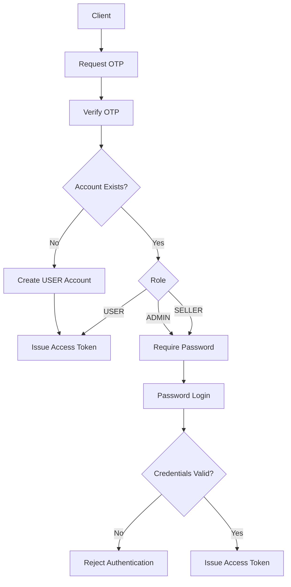

# Authentication System
### 0.18.5
### Co-Fism

## Overview

O-API uses an OTP-based authentication flow. Authentication behavior depends on the user's role.

Normal users can authenticate using OTP, while Admin and Seller accounts require OTP verification followed by password authentication.

The authentication system supports phone number and email identifiers.

## Authentication Flow

The general authentication flow:

1. Request an OTP.
2. Verify the OTP.
3. Identify the account and its role.
4. Continue with the appropriate authentication flow.
5. Issue an access token when authentication is completed.

## OTP Endpoints

| Method | Endpoint | Description |
|---|---|---|
| POST | `/auth/otp/request` | Request an OTP |
| POST | `/auth/otp/verify` | Verify an OTP |

### Request OTP

The client submits a phone number or email address.

The system checks the OTP cooldown, generates a code, stores it, and sends it through the appropriate notification channel.

- Phone number → SMS
- Email → Email

OTP requests are rate-limited, and a Redis cooldown prevents repeated requests during the cooldown period.

### Verify OTP

After receiving the OTP, the client submits the identifier and code.

The system validates the OTP, removes the verified OTP record, and determines the account's authentication flow.

## Role-Based Authentication

Authentication behavior is determined by the account role.

### USER

Normal users authenticate through OTP.

- OTP verification is sufficient for authentication.
- If the account does not exist, a new USER account is created.
- An access token is issued after successful OTP verification.

### ADMIN

Admin accounts require two authentication steps:

1. OTP verification.
2. Password authentication.

OTP verification alone does not issue an access token for Admin accounts. A temporary OTP verification flag is stored in Redis, allowing the client to continue with password login.

### SELLER

Seller accounts follow the same protected authentication flow as Admin accounts:

1. OTP verification.
2. Password authentication.
3. Access token issuance after successful authentication.

## Authentication Flow Diagram

## Password Login

Password login is available through three methods.

| Method | Endpoint |
|---|---|
| Email + Password | `/users/login/email-password` |
| Phone + Password | `/users/login/phone-password` |
| Username + Password | `/users/login/username-password` |

All three methods use a shared password authentication handler.

For Admin and Seller accounts, the handler also checks the temporary OTP verification flag in Redis. Password authentication is rejected if OTP verification has not been completed.

After successful authentication, the OTP verification flag is deleted to prevent its reuse.

## Login Identifier

The system provides an endpoint for identifying an account before login.

`POST /users/login/check-identifier`

It accepts an identifier such as a phone number, email, or username and returns the account role and whether password authentication is required.

This endpoint is used to determine the appropriate authentication flow, but it does not authenticate the user or issue a token.

## OTP Storage and Security

OTP-related state is managed using Redis and the OTP repository abstraction.

- OTP cooldown: 120 seconds.
- OTP request rate limit: 3 requests per 60 seconds.
- OTP verification rate limit: 5 requests per 60 seconds.
- Admin/Seller OTP verification flag: 300 seconds.
- OTP verification flag is removed after successful password login.

## Access Token

JWT tokens are issued after the appropriate authentication requirements have been satisfied.

The token payload includes:

- `sub` — User ID
- `role` — Account role

JWT configuration is managed through the shared authentication module.

## Authentication Responsibilities

**Auth Module**

- OTP request and generation
- OTP verification
- SMS and Email delivery
- OTP cooldown
- Initial account creation for new users
- Role-based authentication flow selection
- OTP verification state for protected accounts

**User Module**

- Identifier lookup
- Password authentication
- Email, phone, and username login
- Role-based credential requirements
- Account status validation
- Access token issuance after successful credential authentication

## Summary

O-API separates OTP verification from password authentication for privileged accounts.

- USER → OTP → Access Token
- ADMIN → OTP → Password → Access Token
- SELLER → OTP → Password → Access Token

This approach provides a separate verification step for accounts with elevated privileges while keeping the normal user authentication flow simple.
