# O-API — Centralized Error Management System
### 0.15.3
### Co-Fism
> A centralized, consistent, and extensible error management architecture for O-API.

## Overview

O-API Error Management is designed to handle exceptions and failures across the entire API request lifecycle.

It provides a unified approach to exception handling, error classification, HTTP status resolution, response standardization, and error tracking, regardless of where an error originates.

The system separates internal exception handling from HTTP response construction, allowing Domain, Application, and Infrastructure layers to remain independent of transport-level concerns.

---

## Objectives
<div align="center">

[](https://skillicons.dev)

</div>
- Centralized exception handling across the API.
- Consistent error responses for all endpoints.
- Separation of business exceptions from HTTP concerns.
- Structured and predictable error codes.
- Controlled HTTP status mapping.
- Safe exposure of error information.
- Support for validation, authentication, authorization, domain, application, and infrastructure errors.
- Extensible exception mapping without coupling business logic to the HTTP layer.
- Improved debugging, traceability, and maintainability.

---

# Request Lifecycle

Every API request follows the general request lifecycle. Depending on the endpoint, some stages may be skipped or additional stages may be introduced.

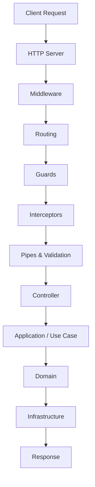

### Lifecycle Stages

1. **Client Request** — Incoming HTTP request.
2. **HTTP Server** — Request parsing and HTTP handling.
3. **Middleware** — Request preprocessing, context, and related concerns.
4. **Routing** — Resolving the request to its endpoint.
5. **Guards** — Authentication and authorization checks.
6. **Interceptors** — Request and response processing.
7. **Pipes & Validation** — Input transformation and validation.
8. **Controller** — Handling the endpoint and delegating execution.
9. **Application / Use Case** — Orchestrating application operations.
10. **Domain** — Enforcing business rules and invariants.
11. **Infrastructure** — Persistence and external service operations.
12. **Response** — Returning the successful result to the client.

---

# Centralized Error Flow

All uncaught exceptions are handled through a centralized error-handling pipeline.

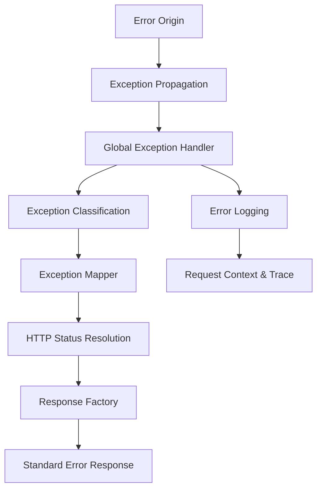

### Error Processing

1. An exception occurs in any request lifecycle stage.
2. The exception propagates through the application.
3. The global exception handler intercepts the uncaught exception.
4. The exception is classified according to its type and source.
5. The Exception Mapper resolves it to a standardized error representation.
6. The HTTP status is determined.
7. The response factory constructs the standardized response.
8. The error is logged with appropriate context.
9. The response is returned to the client.

---

# Error Sources

| Source | Description |
|---|---|
| HTTP / Routing | Invalid requests, unmatched routes, HTTP-level failures |
| Middleware | Request processing and context failures |
| Guards | Authentication and authorization failures |
| Pipes / Validation | DTO validation, transformation, invalid input |
| Controller | Endpoint-level failures |
| Application | Use Case and application logic failures |
| Domain | Business rules, invariants, invalid state |
| Infrastructure | Database, repository, external service failures |
| Unknown | Unclassified or unexpected exceptions |

---

# Capabilities

- **Global Exception Handling** — Centralized handling of uncaught exceptions.
- **Exception Classification** — Categorizing errors based on their type and origin.
- **Domain Exception Support** — Business exceptions independent of HTTP.
- **Application Exception Support** — Application and Use Case error handling.
- **Infrastructure Error Handling** — Controlled handling of infrastructure failures.
- **Exception Mapping** — Mapping internal exceptions to client-facing errors.
- **HTTP Status Resolution** — Determining appropriate HTTP status codes.
- **Standardized Error Contracts** — Consistent response structure.
- **Validation Error Handling** — Processing DTO and input validation errors.
- **Authentication Error Handling** — Handling authentication failures.
- **Authorization Error Handling** — Handling access-control failures.
- **Unknown Exception Fallback** — Safe fallback for unrecognized errors.
- **Safe Error Exposure** — Preventing internal information leaks.
- **Error Logging** — Recording failures for diagnostics.
- **Request Traceability** — Correlating errors with requests.
- **Extensibility** — Supporting new exceptions and mappings.
- **Consistent Error Codes** — Stable machine-readable identifiers.
- **Multiple Validation Errors** — Supporting aggregated validation failures.
- **Stack Trace Control** — Separating internal diagnostic details from client output.

---

# Technology Stack

| Technology | Role |
|---|---|
| TypeScript | Type safety and implementation |
| Node.js | Runtime environment |
| NestJS | API framework and request lifecycle |
| NestJS Exception Filters | Global exception interception |
| `HttpException` | HTTP-related exceptions |
| `ArgumentsHost` | Access to HTTP execution context |
| `ValidationPipe` | Input validation and transformation pipeline |
| `class-validator` | DTO validation |
| `class-transformer` | Input transformation |
| `Error` / `Error.cause` | Exception representation and cause chaining |
| UUID | Request correlation identifiers |
| Logger | Error logging and diagnostics |
| Jest | Unit and integration testing |

---

# Standard Error Response

All API errors follow a standardized response contract.

```json
{
  "success": false,
  "statusCode": 409,
  "error": {
    "code": "USER_INVALID_EMAIL",
    "message": "Email already exists",
    "details": null
  },
  "timestamp": "2026-11-20T08:00:00.000Z",
  "path": "/api/users/email",
  "requestId": "uuid"
}
```

### Response Fields

| Field | Description |
|---|---|
| `success` | Indicates the request failed |
| `statusCode` | HTTP status code |
| `error.code` | Machine-readable error identifier |
| `error.message` | Human-readable error message |
| `error.details` | Optional structured error details |
| `timestamp` | Error occurrence time |
| `path` | Request endpoint |
| `requestId` | Request correlation identifier |

> Clients should rely on the error code rather than the message for programmatic error handling.

---

# HTTP Error Classification

| HTTP Status | Meaning | Typical Source |
|---|---|---|
| 400 | Bad Request | DTO / Validation |
| 401 | Unauthorized | Authentication |
| 403 | Forbidden | Authorization |
| 404 | Not Found | Resource / Routing |
| 409 | Conflict | Domain state / Conflict |
| 422 | Unprocessable Entity | Optional validation convention |
| 429 | Too Many Requests | Rate limiting |
| 500 | Internal Server Error | Unknown / Internal |
| 502 | Bad Gateway | External dependency |
| 503 | Service Unavailable | Service availability |
| 504 | Gateway Timeout | External timeout |

---

# API-Specific Request & Error Flows

Each endpoint has its own execution path and potential failure points. The following diagrams describe the individual lifecycle stages of each API.

## 1. Auth Module

### API 01 — Register

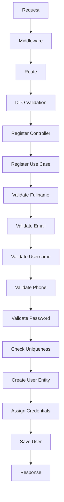

Potential errors: DTO validation, invalid fullname/email/username/phone/password, duplicate values, domain violations, credential assignment, persistence.

### API 02 — Login

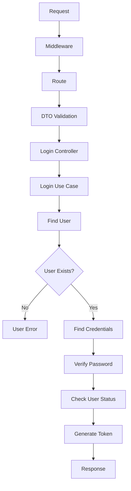

Potential errors: invalid input, user not found, credentials not found, invalid password, invalid user status, token generation, database.

### API 03 — Assign Credentials

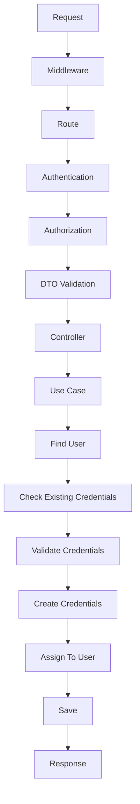

Potential errors: 401, 403, DTO validation, user not found, credentials already assigned, domain, database.

### API 04 — Verify Credentials

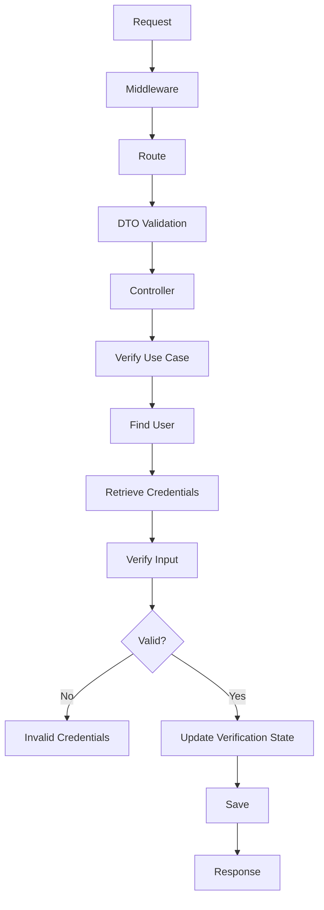

Potential errors: DTO validation, user not found, credentials not found, invalid credentials, verification state, database.

### API 05 — Refresh Token

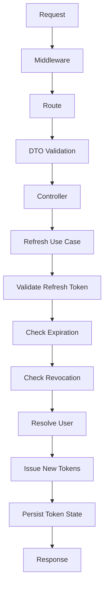

Potential errors: DTO validation, invalid/expired/revoked token, user not found, token service, database.

---

## 2. User Module

### API 06 — Change Email

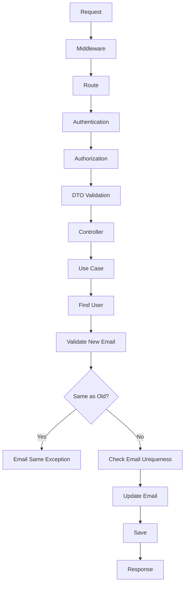

Potential errors: authentication, authorization, DTO, user not found, invalid email, same email, duplicate email, database.

### API 07 — Change Username

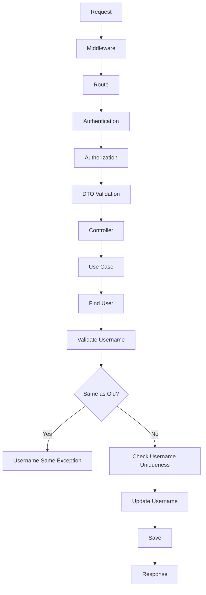

Potential errors: authentication, authorization, DTO, user not found, invalid username, same username, duplicate username, database.

### API 08 — Change Password

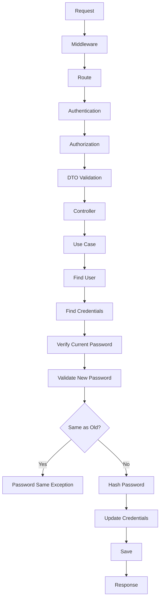

Potential errors: authentication, authorization, DTO, user not found, credentials not found, current password invalid, invalid password, same password, hashing, database.

### API 09 — Change Fullname

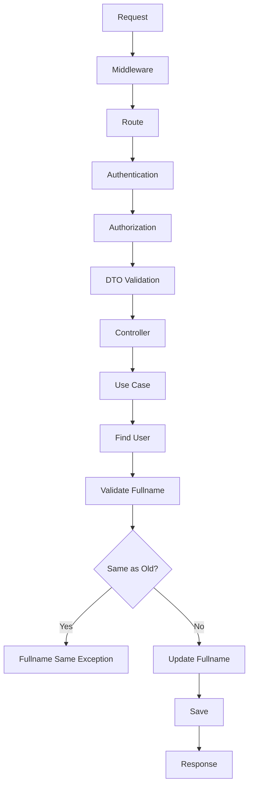

Potential errors: authentication, authorization, DTO, user not found, invalid fullname, fullname unchanged, domain, database.

### API 10 — Change Phone Number

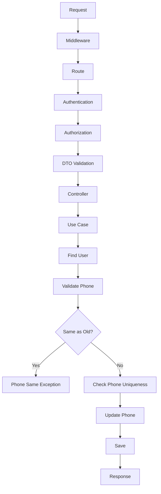

Potential errors: authentication, authorization, DTO, user not found, invalid phone, same phone, duplicate phone, database.

### API 11 — Change Role

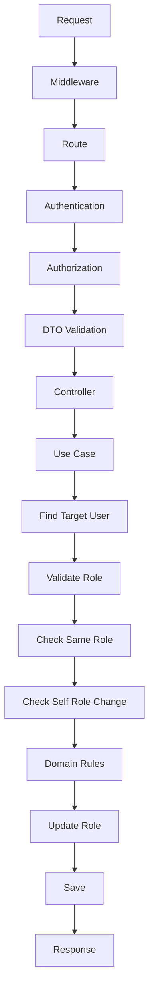

Potential errors: authentication, authorization, DTO, user not found, invalid role, role unchanged, self-role change, domain, database.

### API 12 — Change Status

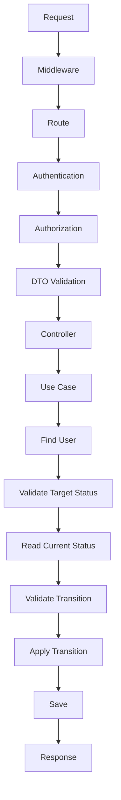

Potential errors: authentication, authorization, DTO, user not found, invalid status, invalid transition, domain, database.

### API 13 — Block User

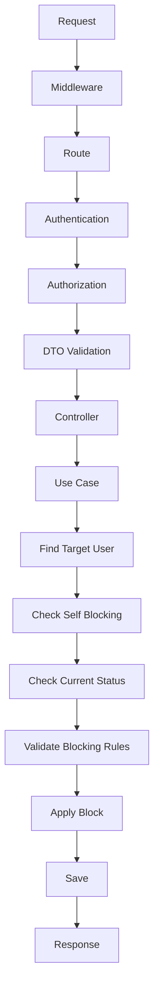

Potential errors: authentication, authorization, DTO, user not found, cannot block yourself, invalid status, domain, database.

### API 14 — Delete User

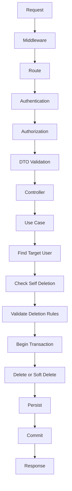

Potential errors: authentication, authorization, DTO, user not found, cannot delete yourself, deletion rule, transaction, database.

### API 15 — Get User

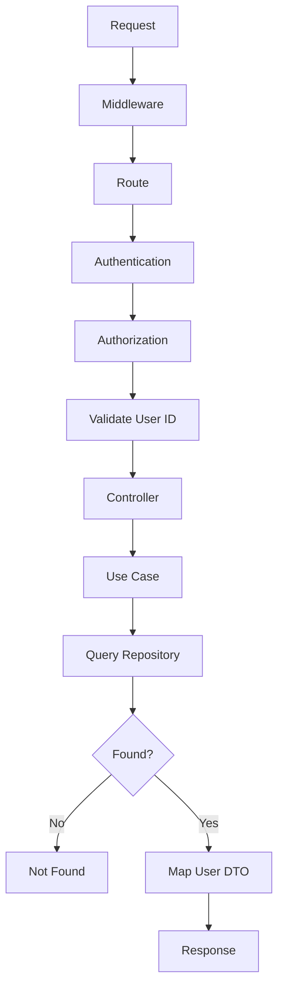

Potential errors: authentication, authorization, invalid user ID, user not found, repository, mapping.

### API 16 — Get Users

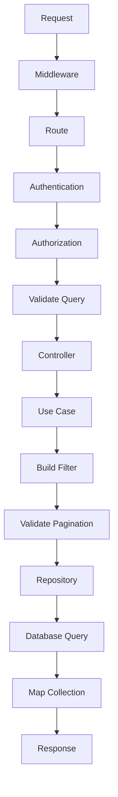

Potential errors: authentication, authorization, query validation, pagination, database, mapping.

### API 17 — Assign Permissions

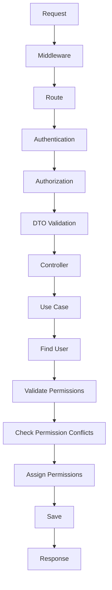

Potential errors: authentication, authorization, DTO, user not found, invalid permissions, permission conflicts, database.

### API 18 — Get User Permissions

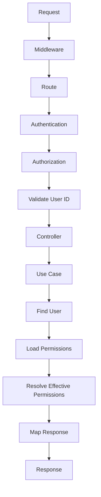

Potential errors: authentication, authorization, invalid ID, user not found, permission query, mapping.

### API 19 — Verify User

```mermaid
flowchart TD
    A[Request] --> B[Middleware]
    B --> C[Route]
    C --> D[Authentication]
    D --> E[Authorization]
    E --> F[DTO Validation]
    F --> G[Controller]
    G --> H[Use Case]
    H --> I[Find User]
    I --> J[Validate Verification Code]
    J --> K[Check Expiration]
    K --> L[Check Already Verified]
    L --> M[Apply Verification]
    M --> N[Save]
    N --> O[Response]
```

Potential errors: authentication, authorization, DTO, user not found, invalid code, expired code, already verified, database.

---

## 3. Address Module

### API 20 — Create Address

```mermaid
flowchart TD
    A[Request] --> B[Middleware]
    B --> C[Route]
    C --> D[Authentication]
    D --> E[DTO Validation]
    E --> F[Controller]
    F --> G[Use Case]
    G --> H[Resolve Owner User]
    H --> I[Validate Address Fields]
    I --> J[Create Address Entity]
    J --> K[Check Default Address Rules]
    K --> L[Repository Save]
    L --> M[Response]
```

Potential errors: authentication, DTO, user not found, invalid address, domain, database.

### API 21 — Get Addresses

```mermaid
flowchart TD
    A[Request] --> B[Middleware]
    B --> C[Route]
    C --> D[Authentication]
    D --> E[Authorization]
    E --> F[Controller]
    F --> G[Use Case]
    G --> H[Resolve Owner]
    H --> I[Query Addresses]
    I --> J[Repository]
    J --> K[Map Address Collection]
    K --> L[Response]
```

Potential errors: authentication, authorization, owner resolution, query, database, mapping.

### API 22 — Get Address By ID

```mermaid
flowchart TD
    A[Request] --> B[Middleware]
    B --> C[Route]
    C --> D[Authentication]
    D --> E[Validate Address ID]
    E --> F[Controller]
    F --> G[Use Case]
    G --> H[Find Address]
    H --> I{Found?}
    I -- No --> J[Not Found]
    I -- Yes --> K[Check Owner Access]
    K --> L[Map Address DTO]
    L --> M[Response]
```

Potential errors: authentication, invalid ID, address not found, ownership forbidden, mapping.

### API 23 — Update Address

```mermaid
flowchart TD
    A[Request] --> B[Middleware]
    B --> C[Route]
    C --> D[Authentication]
    D --> E[DTO Validation]
    E --> F[Controller]
    F --> G[Use Case]
    G --> H[Find Address]
    H --> I[Check Owner]
    I --> J[Validate Updated Fields]
    J --> K[Apply Changes]
    K --> L[Domain Validation]
    L --> M[Save]
    M --> N[Response]
```

Potential errors: authentication, DTO, address not found, owner forbidden, invalid address, domain, database.

### API 24 — Delete Address

```mermaid
flowchart TD
    A[Request] --> B[Middleware]
    B --> C[Route]
    C --> D[Authentication]
    D --> E[Validate Address ID]
    E --> F[Controller]
    F --> G[Use Case]
    G --> H[Find Address]
    H --> I[Check Owner]
    I --> J[Check Address Usage]
    J --> K[Delete Address]
    K --> L[Save]
    L --> M[Response]
```

Potential errors: authentication, invalid ID, address not found, ownership, address in use, database.

---

## 4. Product Module

### API 25 — Create Product

```mermaid
flowchart TD
    A[Request] --> B[Middleware]
    B --> C[Route]
    C --> D[Authentication]
    D --> E[Authorization]
    E --> F[DTO Validation]
    F --> G[Controller]
    G --> H[Use Case]
    H --> I[Validate Product Fields]
    I --> J[Validate Price]
    J --> K[Validate Inventory]
    K --> L[Resolve Categories]
    L --> M[Create Product Entity]
    M --> N[Repository Save]
    N --> O[Response]
```

Potential errors: authentication, authorization, DTO, product validation, price, inventory, category, database.

### API 26 — Get Products

```mermaid
flowchart TD
    A[Request] --> B[Middleware]
    B --> C[Route]
    C --> D[Validate Query]
    D --> E[Controller]
    E --> F[Use Case]
    F --> G[Build Filters]
    G --> H[Build Sort]
    H --> I[Pagination]
    I --> J[Repository Query]
    J --> K[Database]
    K --> L[Map Product List]
    L --> M[Response]
```

Potential errors: query, sorting, pagination, database, mapping.

### API 27 — Get Product By ID

```mermaid
flowchart TD
    A[Request] --> B[Middleware]
    B --> C[Route]
    C --> D[Validate Product ID]
    D --> E[Controller]
    E --> F[Use Case]
    F --> G[Repository Find]
    G --> H{Found?}
    H -- No --> I[Product Not Found]
    H -- Yes --> J[Resolve Product Details]
    J --> K[Map Response]
    K --> L[Response]
```

Potential errors: invalid ID, product not found, repository, mapping.

### API 28 — Update Product

```mermaid
flowchart TD
    A[Request] --> B[Middleware]
    B --> C[Route]
    C --> D[Authentication]
    D --> E[Authorization]
    E --> F[DTO Validation]
    F --> G[Controller]
    G --> H[Use Case]
    H --> I[Find Product]
    I --> J[Validate Updated Fields]
    J --> K[Validate Price and Stock]
    K --> L[Apply Changes]
    L --> M[Domain Rules]
    M --> N[Save]
    N --> O[Response]
```

Potential errors: authentication, authorization, DTO, product not found, invalid fields, domain, database.

### API 29 — Delete Product

```mermaid
flowchart TD
    A[Request] --> B[Middleware]
    B --> C[Route]
    C --> D[Authentication]
    D --> E[Authorization]
    E --> F[Validate Product ID]
    F --> G[Controller]
    G --> H[Use Case]
    H --> I[Find Product]
    I --> J[Check Order References]
    J --> K[Deletion Policy]
    K --> L[Delete or Archive]
    L --> M[Save]
    M --> N[Response]
```

Potential errors: authentication, authorization, product not found, product in use, deletion policy, database.

---

## 5. Review Module

### API 30 — Create Review

```mermaid
flowchart TD
    A[Request] --> B[Middleware]
    B --> C[Route]
    C --> D[Authentication]
    D --> E[DTO Validation]
    E --> F[Controller]
    F --> G[Use Case]
    G --> H[Find Product]
    H --> I[Validate User]
    I --> J[Check Purchase Eligibility]
    J --> K[Check Existing Review]
    K --> L[Validate Rating]
    L --> M[Create Review Entity]
    M --> N[Save]
    N --> O[Response]
```

Potential errors: authentication, DTO, product not found, purchase eligibility, duplicate review, invalid rating, database.

### API 31 — Get Product Reviews

```mermaid
flowchart TD
    A[Request] --> B[Middleware]
    B --> C[Route]
    C --> D[Validate Product ID]
    D --> E[Validate Query]
    E --> F[Controller]
    F --> G[Use Case]
    G --> H[Find Product]
    H --> I[Fetch Reviews]
    I --> J[Pagination]
    J --> K[Calculate Summary]
    K --> L[Map Reviews]
    L --> M[Response]
```

Potential errors: invalid ID, product not found, query, database, calculation, mapping.

### API 32 — Update Review

```mermaid
flowchart TD
    A[Request] --> B[Middleware]
    B --> C[Route]
    C --> D[Authentication]
    D --> E[DTO Validation]
    E --> F[Controller]
    F --> G[Use Case]
    G --> H[Find Review]
    H --> I[Check Owner]
    I --> J[Validate Updated Rating]
    J --> K[Update Review]
    K --> L[Domain Rules]
    L --> M[Save]
    M --> N[Response]
```

Potential errors: authentication, DTO, review not found, owner forbidden, invalid rating, domain, database.

### API 33 — Delete Review

```mermaid
flowchart TD
    A[Request] --> B[Middleware]
    B --> C[Route]
    C --> D[Authentication]
    D --> E[Authorization]
    E --> F[Validate Review ID]
    F --> G[Controller]
    G --> H[Use Case]
    H --> I[Find Review]
    I --> J[Check Ownership or Admin]
    J --> K[Validate Deletion]
    K --> L[Delete Review]
    L --> M[Update Aggregates]
    M --> N[Save]
    N --> O[Response]
```

Potential errors: authentication, authorization, invalid ID, review not found, ownership, domain, database.

---

## 6. Cart Module

### API 34 — Get Cart

```mermaid
flowchart TD
    A[Request] --> B[Middleware]
    B --> C[Route]
    C --> D[Authentication]
    D --> E[Controller]
    E --> F[Use Case]
    F --> G[Resolve User]
    G --> H[Find or Create Cart]
    H --> I[Load Cart Items]
    I --> J[Resolve Product Data]
    J --> K[Calculate Totals]
    K --> L[Map Cart]
    L --> M[Response]
```

Potential errors: authentication, user, cart retrieval/creation, product resolution, calculation, database.

### API 35 — Add Item To Cart

```mermaid
flowchart TD
    A[Request] --> B[Middleware]
    B --> C[Route]
    C --> D[Authentication]
    D --> E[DTO Validation]
    E --> F[Controller]
    F --> G[Use Case]
    G --> H[Find Cart]
    H --> I[Find Product]
    I --> J[Check Availability]
    J --> K[Validate Quantity]
    K --> L[Find Existing Item]
    L --> M[Add or Increase Quantity]
    M --> N[Recalculate Cart]
    N --> O[Save]
    O --> P[Response]
```

Potential errors: authentication, DTO, cart, product not found, product unavailable, invalid quantity, stock, database.

### API 36 — Update Cart Item

```mermaid
flowchart TD
    A[Request] --> B[Middleware]
    B --> C[Route]
    C --> D[Authentication]
    D --> E[DTO Validation]
    E --> F[Controller]
    F --> G[Use Case]
    G --> H[Find Cart]
    H --> I[Find Cart Item]
    I --> J[Find Product]
    J --> K[Validate Quantity]
    K --> L[Check Stock]
    L --> M[Update Item]
    M --> N[Recalculate Totals]
    N --> O[Save]
    O --> P[Response]
```

Potential errors: authentication, DTO, cart not found, item not found, product not found, invalid quantity, stock, database.

### API 37 — Remove Cart Item

```mermaid
flowchart TD
    A[Request] --> B[Middleware]
    B --> C[Route]
    C --> D[Authentication]
    D --> E[Validate Item ID]
    E --> F[Controller]
    F --> G[Use Case]
    G --> H[Find Cart]
    H --> I[Find Item]
    I --> J[Validate Removal]
    J --> K[Remove Item]
    K --> L[Recalculate Cart]
    L --> M[Save]
    M --> N[Response]
```

Potential errors: authentication, invalid ID, cart not found, item not found, removal rule, database.

---

## 7. Order Module

### API 38 — Create Order

```mermaid
flowchart TD
    A[Request] --> B[Middleware]
    B --> C[Route]
    C --> D[Authentication]
    D --> E[DTO Validation]
    E --> F[Controller]
    F --> G[Use Case]
    G --> H[Load Cart]
    H --> I[Validate Cart]
    I --> J[Resolve Address]
    J --> K[Validate Stock]
    K --> L[Calculate Final Price]
    L --> M[Begin Transaction]
    M --> N[Reserve or Update Stock]
    N --> O[Create Order]
    O --> P[Create Order Items]
    P --> Q[Persist]
    Q --> R[Commit]
    R --> S[Response]
```

Potential errors: authentication, DTO, empty cart, invalid address, stock, price calculation, transaction, database.

### API 39 — Get Order

```mermaid
flowchart TD
    A[Request] --> B[Middleware]
    B --> C[Route]
    C --> D[Authentication]
    D --> E[Validate Order ID]
    E --> F[Controller]
    F --> G[Use Case]
    G --> H[Find Order]
    H --> I[Check Ownership]
    I --> J[Load Order Items]
    J --> K[Load Payment Info]
    K --> L[Map Order Details]
    L --> M[Response]
```

Potential errors: authentication, invalid ID, order not found, ownership, data resolution, mapping.

### API 40 — Get Orders

```mermaid
flowchart TD
    A[Request] --> B[Middleware]
    B --> C[Route]
    C --> D[Authentication]
    D --> E[Authorization]
    E --> F[Validate Filters]
    F --> G[Controller]
    G --> H[Use Case]
    H --> I[Build Order Query]
    I --> J[Pagination]
    J --> K[Repository]
    K --> L[Database]
    L --> M[Map Orders]
    M --> N[Response]
```

Potential errors: authentication, authorization, filters, pagination, database, mapping.

### API 41 — Cancel Order

```mermaid
flowchart TD
    A[Request] --> B[Middleware]
    B --> C[Route]
    C --> D[Authentication]
    D --> E[DTO Validation]
    E --> F[Controller]
    F --> G[Use Case]
    G --> H[Find Order]
    H --> I[Check Owner]
    I --> J[Validate Order Status]
    J --> K[Check Payment State]
    K --> L[Apply Cancellation]
    L --> M[Release Reserved Stock]
    M --> N[Update Order]
    N --> O[Transaction]
    O --> P[Save]
    P --> Q[Response]
```

Potential errors: authentication, DTO, order not found, ownership, invalid status, payment state, stock release, transaction, database.

---

## 8. Payment Module

### API 42 — Initiate Payment

```mermaid
flowchart TD
    A[Request] --> B[Middleware]
    B --> C[Route]
    C --> D[Authentication]
    D --> E[DTO Validation]
    E --> F[Controller]
    F --> G[Use Case]
    G --> H[Find Order]
    H --> I[Validate Ownership]
    I --> J[Validate Order State]
    J --> K[Calculate Payment Amount]
    K --> L[Create Payment Record]
    L --> M[Request Payment Gateway]
    M --> N[Store Gateway Reference]
    N --> O[Save]
    O --> P[Response]
```

Potential errors: authentication, DTO, order not found, ownership, order state, amount, gateway, database.

### API 43 — Verify Payment

```mermaid
flowchart TD
    A[Callback or Request] --> B[Middleware]
    B --> C[Route]
    C --> D[Validate Callback Data]
    D --> E[Controller]
    E --> F[Verification Use Case]
    F --> G[Find Payment]
    G --> H[Check Gateway Reference]
    H --> I[Gateway Verification]
    I --> J{Payment Successful?}
    J -- No --> K[Failure State]
    J -- Yes --> L[Validate Amount]
    L --> M[Validate Payment State]
    M --> N[Update Payment]
    N --> O[Update Order]
    O --> P[Transaction]
    P --> Q[Save]
    Q --> R[Response]
```

Potential errors: invalid callback, payment not found, reference invalid, gateway failure, amount mismatch, duplicate verification, state conflict, database.

### API 44 — Get Payment

```mermaid
flowchart TD
    A[Request] --> B[Middleware]
    B --> C[Route]
    C --> D[Authentication]
    D --> E[Validate Payment ID]
    E --> F[Controller]
    F --> G[Use Case]
    G --> H[Find Payment]
    H --> I[Check Ownership]
    I --> J[Load Payment Details]
    J --> K[Map Payment DTO]
    K --> L[Response]
```

Potential errors: authentication, invalid ID, payment not found, ownership, database, mapping.

---

## 9. Notification Module

### API 45 — Get Notifications

```mermaid
flowchart TD
    A[Request] --> B[Middleware]
    B --> C[Route]
    C --> D[Authentication]
    D --> E[Validate Query]
    E --> F[Controller]
    F --> G[Use Case]
    G --> H[Resolve User]
    H --> I[Build Notification Query]
    I --> J[Pagination]
    J --> K[Repository]
    K --> L[Fetch Notifications]
    L --> M[Map Notification DTOs]
    M --> N[Response]
```

Potential errors: authentication, query validation, pagination, user resolution, database, mapping.

---

# API Summary

| # | Module | API |
|---:|---|---|
| 01 | Auth | Register |
| 02 | Auth | Login |
| 03 | Auth | Assign Credentials |
| 04 | Auth | Verify Credentials |
| 05 | Auth | Refresh Token |
| 06 | User | Change Email |
| 07 | User | Change Username |
| 08 | User | Change Password |
| 09 | User | Change Fullname |
| 10 | User | Change Phone Number |
| 11 | User | Change Role |
| 12 | User | Change Status |
| 13 | User | Block User |
| 14 | User | Delete User |
| 15 | User | Get User |
| 16 | User | Get Users |
| 17 | User | Assign Permissions |
| 18 | User | Get User Permissions |
| 19 | User | Verify User |
| 20 | Address | Create Address |
| 21 | Address | Get Addresses |
| 22 | Address | Get Address By ID |
| 23 | Address | Update Address |
| 24 | Address | Delete Address |
| 25 | Product | Create Product |
| 26 | Product | Get Products |
| 27 | Product | Get Product By ID |
| 28 | Product | Update Product |
| 29 | Product | Delete Product |
| 30 | Review | Create Review |
| 31 | Review | Get Product Reviews |
| 32 | Review | Update Review |
| 33 | Review | Delete Review |
| 34 | Cart | Get Cart |
| 35 | Cart | Add Item To Cart |
| 36 | Cart | Update Cart Item |
| 37 | Cart | Remove Cart Item |
| 38 | Order | Create Order |
| 39 | Order | Get Order |
| 40 | Order | Get Orders |
| 41 | Order | Cancel Order |
| 42 | Payment | Initiate Payment |
| 43 | Payment | Verify Payment |
| 44 | Payment | Get Payment |
| 45 | Notification | Get Notifications |

---

# Error Management Architecture

```mermaid
flowchart TD
    A[45 API Endpoints] --> B[Request Lifecycle]
    B --> C[Endpoint Logic]
    C --> D[Error Sources]
    D --> E[Global Exception Handling]
    E --> F[Exception Classification]
    F --> G[Exception Mapping]
    G --> H[HTTP Status Resolution]
    H --> I[Response Factory]
    I --> J[Standardized Response]
    E --> K[Error Logging]
    K --> L[Request Traceability]
```

## Design Principles

- **Centralized** — One global error-handling system.
- **Consistent** — Every endpoint follows a predictable error contract.
- **Layered** — Domain, Application, and Infrastructure remain separated.
- **Type-safe** — Error handling benefits from TypeScript's type system.
- **Extensible** — New errors and endpoints can be added without rewriting the system.
- **Secure** — Internal exception details are not exposed to clients.
- **Traceable** — Errors can be correlated with requests and logs.
- **Maintainable** — Mapping logic is not duplicated throughout controllers.
- **Predictable** — Clients receive stable error codes and status mappings.

---

# Final Goal

The Error Management System provides O-API with a unified infrastructure for processing errors across all endpoints, creating a predictable contract between backend and clients while preserving the separation of concerns between application layers.

Every endpoint can have its own execution path and domain-specific exceptions, but all uncaught errors ultimately converge into a centralized exception-handling pipeline.

**One API architecture. One error contract. One centralized exception-handling system.**
